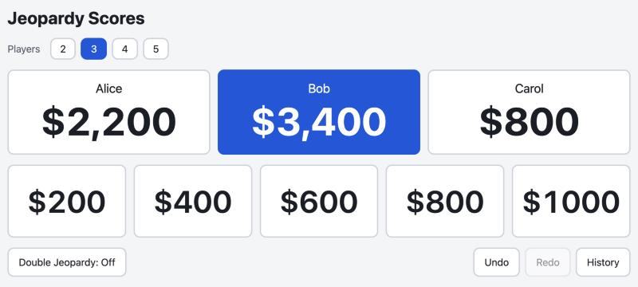

# Jeopardy Scores

A score keeper for a game of Jeopardy with 2–5 players, built for an iPad but usable in any browser.

Live at https://jeopardy-scores.web.app



## Features

- Tap a player to select them, then tap an amount ($200–$1000) to award it.
- Double Jeopardy toggle that doubles the amounts.
- Undo, redo, and a history list where any award can be deleted.
- Press and hold a player to rename them. Names are saved in the browser.

Scores are kept in memory, so refreshing the page starts a new game.

## Requirements

- [Node.js](https://nodejs.org) 20.19 or later, or 22.12 or later
- npm (comes with Node.js)

## Getting started

Install the dependencies:

```bash
npm install
```

Start the dev server with hot reloading, at http://localhost:5173:

```bash
npm start
```

## Building

```bash
npm run build
```

This type-checks the code and writes the site (`index.html` plus the compiled JavaScript and CSS) to the `public` directory. Those files are static and can be served by any web host.

To try the built site locally:

```bash
npm run preview
```

## Deploying

The site is hosted on Firebase Hosting. Deploying needs the [Firebase CLI](https://firebase.google.com/docs/cli) and access to the `jeopardy-scores` Firebase project:

```bash
npm run deploy
```

This builds the site and publishes the `public` directory. To deploy to your own Firebase project, change the project ID in `.firebaserc`.

## Project layout

- `index.html` — the page Vite builds from
- `src/` — the app, written in TypeScript and React
- `public/` — build output, checked in; regenerate it with `npm run build`

Built with [Vite](https://vite.dev), [React](https://react.dev) and [TypeScript](https://www.typescriptlang.org).
